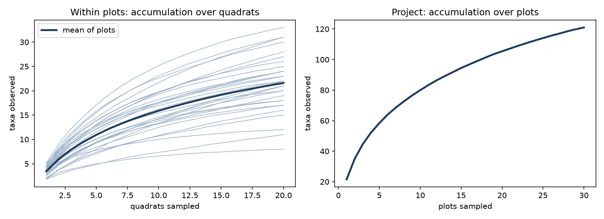
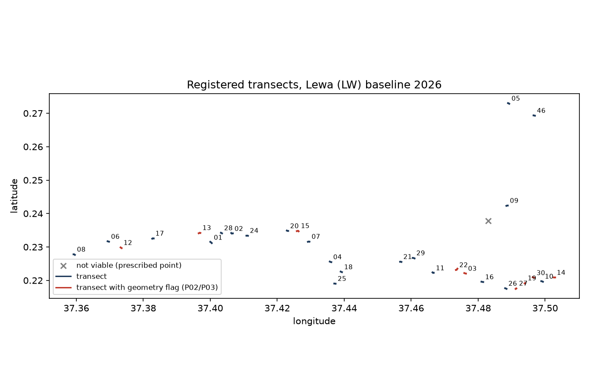

# Herbaceous Vegetation: Data Quality Report

**Project:** Savanna Monitoring Pilot, Lewa (Kenya), 2026 baseline survey
**Data:** 32 survey submissions with 640 quadrats, and 31 plot registrations, collected 19–27 May 2026
**Analysis:** [notebooks/vegetation.ipynb](../../../notebooks/vegetation.ipynb). Flag list: [flags.csv](flags.csv).

Problems in the data are **flagged, not fixed**. No submitted value was changed.

## How the survey works

- **Plot.** Each plot is a strip of ground 50 m long and 5 m wide, called a belt transect. Its midpoint is a GPS point set in advance by the sampling design. The team lays a tape measure north–south through that point. It records three GPS points in a registration form: endpoint A, the midpoint and endpoint B.
- **Strata and backups.** The design splits the project area into habitat types, called strata: savanna and shrubland. Each stratum has primary plots. If a primary plot cannot be sampled, the team declares it "not viable" and uses a backup plot instead.
- **Quadrats.** Along the tape, the team places 20 square frames of 1 m × 1 m, called quadrats. They sit every 5 m, alternating sides, 1.5–2.5 m from the tape. In each quadrat the team records every herbaceous species rooted inside it: grasses, forbs (broad-leaved herbs), sedges and succulents.
- **Species names.** The team picks species from the project's species list. A species not on the list is typed in by name. A species the team cannot identify gets a provisional code such as `herb_007`, and a botanist identifies it later from photos and specimens.
- **Counting.** A *taxon* is one distinct species or one unidentified provisional code. *Richness* is the number of taxa found.
- **Review.** Submissions can be reviewed and rejected in ODK, the data collection system. A rejected submission stays in the data but is excluded from all results.

**Flags.** Each data problem gets a check ID. The letter gives the level: **S** survey, **P** plot, **Q** quadrat, **T** taxonomy (species names). An *error* must be fixed or accepted before the data are used. A *warning* needs a person to look at it. *Info* is context only. The [appendix](#appendix-checks) explains every check.

## Key findings

1. **One of the two habitat types was not sampled.** No shrubland plot was registered or surveyed, so every result describes savanna only. The savanna stratum is complete: 29 of 30 primary plots plus 1 backup.
2. **Every transect runs roughly east–west instead of north–south**, with bearings of 50–130° (`P04`). The SOP allows turning a transect only to avoid an obstacle, so this points to a misunderstanding of the protocol.
3. **Locations need review on 20 of the 30 surveyed plots.**
   - Plot 14's midpoint is 34 m from its planned point, where the SOP allows 25 m (`P02`).
   - On 9 plots an endpoint is not about 25 m from the midpoint, so the transect has the wrong length (`P03`).
   - 33 quadrats on 16 plots lie outside the 50 m × 5 m strip (`Q01`).
   - On Plots 5, 7, 13 and 27 the quadrats sit a median 10–22 m from the registered transect line (`Q02`). The survey was probably done along a different line than the one registered.
4. **The project species list does not fit this site.** Only 42 % of species records were picked from the list, and only 28 of its 238 herbaceous species were used. The rest were typed in or recorded as unknown. The SOP intends this only as a rare fallback.
5. **Species names need cleaning before richness is reported.** Fixing the issues below would lower total richness from 121 to about 114 taxa.
   - 28 provisional codes are still unidentified, covering 317 species records (`T02`).
   - 19 written-out names are misspelled or not recognised by GBIF, the global species name database. Examples are *Crotolaria* for *Crotalaria* and *Ipomea* for *Ipomoea* (`T03`).
   - 7 species were given more than one provisional code, and 4 codes are marked as duplicates in the identification list (`T05`, `T07`).
   - The woody shrub *Rhus tenuinervis* was recorded as a herb (`T06`).
6. **Some species records are probably missing.** In 10 quadrats the recorder answered "yes, there are species that are not on the list or cannot be identified" but then recorded none (`Q04`). In one more quadrat, an extra species entry was created but left empty (`T01`).
7. **Duplicate surveys were handled correctly.** Plots 18 and 21 were each surveyed twice on 26 May. The short afternoon repeats were rejected in review (`S01`, `S02`). Plot 29 was surveyed earlier that day on the same device and also has no end-of-survey GPS point. It was not rejected and should be checked (`S03`).
8. **Device clocks are probably set to the wrong time zone.** All timestamps are UTC+02:00, but Kenya is UTC+03:00. Local times in the data are therefore one hour early.

## a. Survey-level summary

One row per submission. *Quadrats with herbs* counts how many of the 20 quadrats had any herbaceous plant. *Species records* counts every species found in every quadrat, so a species found in 5 quadrats counts 5 times. *Taxa* counts distinct species.

| Plot | Date | Recorder | Minutes | Rejected | Quadrats with herbs | Species records | Taxa | Unidentified taxa | Flags |
|---|---|---|---:|---|---:|---:|---:|---:|---|
| Plot 01 | May 23 | Grace | 70 |  | 20 | 89 | 31 | 2 | Q01, Q03 |
| Plot 02 | May 24 | Grace | 100 |  | 19 | 50 | 18 | 1 | Q01, Q05 |
| Plot 03 | May 20 | Sam | 59 |  | 18 | 43 | 15 | 7 | Q01, Q05 |
| Plot 04 | May 25 | Grace | 56 |  | 19 | 52 | 20 | 6 | Q01, Q05 |
| Plot 05 | May 22 | Grace | 102 |  | 19 | 43 | 16 | 1 | Q01, Q02, Q05 |
| Plot 06 | May 23 | Grace | 92 |  | 20 | 79 | 24 | 4 | Q01 |
| Plot 07 | May 24 | Grace | 56 |  | 20 | 75 | 18 | 5 | Q02 |
| Plot 08 | May 19 | Sam | 236 |  | 20 | 103 | 26 | 3 | S05 |
| Plot 09 | May 21 | Grace | 82 |  | 20 | 90 | 27 | 4 | Q01 |
| Plot 10 | May 21 | Grace | 63 |  | 20 | 68 | 21 | 1 | Q04 |
| Plot 11 | May 26 | Grace | 54 |  | 20 | 73 | 25 | 2 | Q01, T08 |
| Plot 12 | May 20 | Sam | 165 |  | 20 | 108 | 33 | 4 | Q01, T08 |
| Plot 13 | May 23 | Grace | 70 |  | 20 | 66 | 12 | 3 | Q02 |
| Plot 14 | May 21 | Grace | 58 |  | 20 | 78 | 17 | 2 | Q04 |
| Plot 15 | May 24 | Grace | 60 |  | 20 | 40 | 21 | 1 | Q01, Q04 |
| Plot 16 | May 27 | Grace | 51 |  | 20 | 90 | 23 | 3 |  |
| Plot 17 | May 23 | Grace | 44 |  | 20 | 76 | 22 | 6 |  |
| Plot 18 | May 26 | Grace | 53 |  | 20 | 73 | 28 | 5 | S02, T08 |
| Plot 18 | May 26 | Grace | 26 | yes | 20 | 72 | 25 | 4 | S01, S02, S03, S05, T08 |
| Plot 19 | May 22 | Grace | 60 |  | 19 | 54 | 19 | 1 | Q01, Q04, Q05 |
| Plot 20 | May 24 | Grace | 54 |  | 20 | 56 | 17 | 0 |  |
| Plot 21 | May 26 | Grace | 68 |  | 20 | 93 | 30 | 4 | S02, Q01 |
| Plot 21 | May 26 | Sam | 25 | yes | 20 | 78 | 30 | 5 | S01, S02, S03, S05, Q01, Q04 |
| Plot 22 | May 20 | Sam | 73 |  | 20 | 65 | 20 | 4 | Q01, T08 |
| Plot 24 | May 24 | Grace | 38 |  | 20 | 38 | 11 | 1 |  |
| Plot 25 | May 25 | Grace | 63 |  | 20 | 84 | 31 | 3 | Q01 |
| Plot 26 | May 22 | Grace | 110 |  | 20 | 64 | 23 | 4 | Q01 |
| Plot 27 | May 22 | Grace | 67 |  | 20 | 73 | 22 | 3 | Q02 |
| Plot 28 | May 23 | Grace | 64 |  | 19 | 63 | 22 | 4 | Q05, T01 |
| Plot 29 | May 26 | Sam | 42 |  | 20 | 85 | 24 | 2 | S03, Q04 |
| Plot 30 | May 21 | Grace | 101 |  | 20 | 81 | 24 | 3 | S03, Q01, Q04 |
| Plot 46 | May 22 | Grace | 33 |  | 20 | 41 | 8 | 1 | Q04 |

For the 30 accepted surveys:

- Each survey has 38–108 species records (median 73) and 8–33 taxa (median 22).
- 7 quadrats had no herbaceous plants, which is plausible in savanna (`Q05`).
- The same three-person team did every survey. Grace recorded 25 surveys and Sam recorded 5.
- A survey took 63 minutes at the median. Plot 8, on the first day, took 236 minutes (`S05`).

## b. Plot-level summary

Richness uses the accepted survey of each plot.

- *Midpoint shift* is the distance between the recorded midpoint and the planned point. The SOP allows up to 25 m.
- *A / B to midpoint* should each be about 25 m.
- *Bearing* is the direction of the transect: 0° is north–south and 90° is east–west.
- *Chao2* estimates how many taxa the plot really has, including ones the 20 quadrats missed. It is based on how many taxa were found in only one or two quadrats. *Completeness* is observed taxa divided by Chao2.

| Plot | Type | Midpoint shift (m) | A / B to midpoint (m) | Bearing (°) | Taxa | Taxa per quadrat | Chao2 | Completeness | Unidentified | Flags |
|---|---|---:|---|---:|---:|---:|---:|---:|---:|---|
| Plot 01 | primary | 11 | 33 / 31 | 130 | 31 | 4.5 | 43 | 71% | 2 | P04 |
| Plot 02 | primary | 13 | 27 / 35 | 103 | 18 | 2.5 | 21 | 86% | 1 | P04 |
| Plot 03 | primary | 5 | 37 / 21 | 107 | 15 | 2.1 | 20 | 75% | 7 | P03, P04 |
| Plot 04 | primary | 6 | 26 / 28 | 109 | 20 | 2.6 | 26 | 78% | 6 | P04, P06 |
| Plot 05 | primary | 20 | 27 / 20 | 116 | 16 | 2.1 | 25 | 65% | 1 | P04 |
| Plot 06 | primary | 4 | 25 / 23 | 106 | 24 | 4.0 | 28 | 85% | 4 | P04 |
| Plot 07 | primary | 6 | 34 / 20 | 85 | 18 | 3.8 | 20 | 92% | 5 | P04 |
| Plot 08 | primary | 6 | 23 / 28 | 112 | 26 | 5.2 | 29 | 90% | 3 | P04 |
| Plot 09 | primary | 5 | 27 / 20 | 78 | 27 | 4.5 | 46 | 59% | 4 | P04 |
| Plot 10 | primary | 10 | 28 / 30 | 109 | 21 | 3.4 | 47 | 45% | 1 | P04 |
| Plot 11 | primary | 12 | 27 / 21 | 108 | 25 | 3.6 | 30 | 82% | 2 | P04 |
| Plot 12 | primary | 12 | 11 / 31 | 123 | 33 | 5.2 | 40 | 83% | 4 | P03, P04 |
| Plot 13 | primary | 14 | 40 / 21 | 78 | 12 | 3.3 | 12 | 98% | 3 | P03, P04 |
| Plot 14 | primary | 34 | 11 / 33 | 91 | 17 | 3.9 | 19 | 89% | 2 | P02, P03, P04 |
| Plot 15 | primary | 15 | 46 / 23 | 96 | 21 | 2.0 | 36 | 59% | 1 | P03, P04 |
| Plot 16 | primary | 4 | 33 / 25 | 100 | 23 | 4.5 | 34 | 67% | 3 | P04 |
| Plot 17 | primary | 24 | 19 / 33 | 82 | 22 | 3.8 | 29 | 76% | 6 | P04 |
| Plot 18 | primary | 3 | 25 / 21 | 113 | 28 | 3.6 | 53 | 53% | 5 | P04 |
| Plot 19 | primary | 4 | 15 / 8 | 60 | 19 | 2.7 | 33 | 57% | 1 | P03, P04 |
| Plot 20 | primary | 5 | 22 / 25 | 105 | 17 | 2.8 | 19 | 88% | 0 | P04 |
| Plot 21 | primary | 14 | 18 / 28 | 98 | 30 | 4.7 | 43 | 71% | 4 | P04 |
| Plot 22 | primary | 18 | 23 / 47 | 50 | 20 | 3.2 | 22 | 89% | 4 | P03, P04 |
| Plot 23 | primary, not viable |  |  |  |  |  |  |  |  | P01 |
| Plot 24 | primary | 6 | 26 / 26 | 93 | 11 | 1.9 | 31 | 36% | 1 | P04 |
| Plot 25 | primary | 3 | 23 / 20 | 96 | 31 | 4.2 | 41 | 75% | 3 | P04 |
| Plot 26 | primary | 8 | 20 / 31 | 113 | 23 | 3.2 | 25 | 90% | 4 | P04 |
| Plot 27 | primary | 20 | 29 / 4 | 57 | 22 | 3.6 | 27 | 82% | 3 | P03, P04 |
| Plot 28 | primary | 1 | 15 / 25 | 118 | 22 | 3.1 | 51 | 43% | 4 | P04 |
| Plot 29 | primary | 8 | 30 / 32 | 105 | 24 | 4.2 | 38 | 63% | 2 | P04 |
| Plot 30 | primary | 14 | 40 / 12 | 110 | 24 | 4.0 | 37 | 65% | 3 | P03, P04 |
| Plot 46 | backup | 6 | 23 / 24 | 102 | 8 | 2.0 | 8 | 94% | 1 | P04 |

- **Richness** is 8–33 taxa per plot, with a mean of 21.6. A single quadrat holds 1.9–5.2 taxa on average per plot. Plot 3 is the most uncertain, because 7 of its 15 taxa are unidentified.
- **Plot 4** was registered as *Forest* with a 10 m canopy, inside the savanna stratum (`P06`). The SOP says a clear mismatch between stratum and habitat is a reason to declare a plot not viable. The form's ecosystem list has no *Savanna* option, which is probably why all other plots are recorded as *Scrub*.
- **Plot 23** was declared not viable because it is "on private property" (`P01`). The SOP says a plot should not be declared not viable for a temporary reason, so it should be confirmed whether access could be arranged next time.

## c. Assessment of sampling effort

| Stratum | Plot type | Planned | Registered | Not viable | Surveyed |
|---|---|---:|---:|---:|---:|
| savanna | backup | 10 | 1 | 0 | 1 |
| savanna | primary | 30 | 30 | 1 | 29 |
| shrubland | backup | 5 | 0 | 0 | 0 |
| shrubland | primary | 6 | 0 | 0 | 0 |

The savanna design was completed as intended, with backup Plot 46 replacing Plot 23. The shrubland stratum is missing entirely. Unless this was planned, the baseline cannot be compared across both habitats later.

The curves show how many taxa have been found after sampling 1, 2, 3 … quadrats (left) or plots (right). A curve that flattens means more sampling would find few new species.

- **20 quadrats find about three quarters of each plot's species.** The curves are still rising at the 20th quadrat, which adds 0.44 new taxa on average. Completeness has a median of 76 %, and is lowest on Plots 24, 28 and 10.
- **30 plots do not find all the savanna species.** They found 121 taxa, while Chao2 estimates 159. The 30th plot still adds 1.2 new taxa on average.
- **Effort is identical on every plot**, which is what matters for comparing plots and tracking change over time. If an absolute richness value is needed, report Chao2 next to the observed count.

The naming problems in finding 5 inflate both estimates slightly, because each misspelling or duplicate code looks like an extra rare species.

## d. Map of transect locations

Each short line is one registered transect, from endpoint A through the midpoint to endpoint B, labelled with its plot number. Red transects have a midpoint or length flag (`P02`, `P03`). The grey cross marks the planned point of Plot 23, which was not sampled. The notebook also draws each plot at metre scale against its planned position.

## Recommended actions

| Priority | Action | Who |
|---|---|---|
| 1 | Confirm whether the shrubland stratum will still be surveyed for this baseline. | Project Delivery |
| 2 | Clarify the north–south rule with the field team, and decide whether the east–west transects are kept. | Project Delivery, Biometrics |
| 3 | Review Plot 14, the four plots with quadrats off the transect line, Plot 29, and the 10 quadrats with missing species. | Project Delivery with the field team |
| 4 | Identify the 28 unknown species, correct the 19 flagged names and merge duplicate codes. Make these fixes in the identification list, not in the survey data. | Species identification contact named in the SOP (mrogan@naturalstate.org) |
| 5 | Add the species found here to the project species list, and add *Savanna* to the ecosystem types. | Natural State form and list owners |
| 6 | Set the field devices to the Africa/Nairobi time zone. | Field team lead |

## Appendix: checks

Each rule comes from the SOPs or the ODK form unless marked as an assumption. Checks cover all 32 submissions, including the two rejected ones. Checks marked \* are not yet written to [flags.csv](flags.csv) by the notebook.

| Check | Severity | Rule | Why | Found |
|---|---|---|---|---:|
| S01 | info | Submission rejected in review | Excluded from results | 2 surveys |
| S02 | warning | Plot surveyed more than once | Would count the plot twice | 4 surveys |
| S03\* | warning | End-of-survey GPS point missing or worse than 5 m | SOP requires 5 m accuracy | 4 surveys |
| S04\* | warning | Survey finished more than 100 m from the plot | Assumption: form is completed at the plot | 0 |
| S05 | warning | Survey shorter than 30 or longer than 180 minutes | Assumption: rushed or interrupted survey | 3 surveys |
| P01 | info | Plot declared not viable | Explains a missing plot | 1 plot |
| P02 | error | Midpoint more than 25 m from the planned point | SOP limit | 1 plot |
| P03 | warning | Endpoint not 25 ± 10 m from the midpoint | 50 m transect, ±10 m for two GPS errors | 9 plots |
| P04 | warning | Transect more than 45° off north–south | SOP orientation | 30 plots |
| P05\* | warning | Transect GPS point worse than 5 m | SOP and form accuracy | 0 |
| P06\* | warning | Ecosystem type does not match the stratum | SOP reason for non-viability | 1 plot |
| Q01 | warning | Quadrat more than 32.5 m from the midpoint | 25 m half-length + 2.5 m half-width + 5 m GPS | 33 quadrats |
| Q02\* | warning | Quadrats a median of more than 10 m from the transect line | Quadrats belong 1.5–2.5 m from the line | 4 surveys |
| Q03\* | warning | Two quadrats of one survey share exact coordinates | Quadrats are 5 m apart | 2 quadrats |
| Q04 | error | "Species not on list" answered yes, but none recorded | Records lost | 10 quadrats |
| Q05\* | info | No herbaceous plants in the quadrat | SOP asks to double-check empty quadrats | 7 quadrats |
| T01 | error | Additional-species entry without a species | Record lost | 1 entry |
| T02 | warning | Provisional code not yet identified | Counts as a separate unknown species | 28 taxa |
| T03 | warning | Written-out name has no exact species match in GBIF | Typos create extra species | 19 names |
| T04\* | warning | Typed as missing but already on the species list | List not used | 1 name |
| T05\* | warning | Same species under several provisional codes | Codes should be reused | 7 species |
| T06 | warning | Woody species recorded as a herb | Out of scope | 1 species |
| T07\* | warning | Provisional code marked as a duplicate in the identification list | Inflates richness | 4 codes |
| T08\* | warning | Same species recorded twice in one quadrat | Double count | 7 quadrats |

The 30–180 minute duration window, the 100 m distance and the 10 m line offset are assumptions for Project Delivery to confirm.
